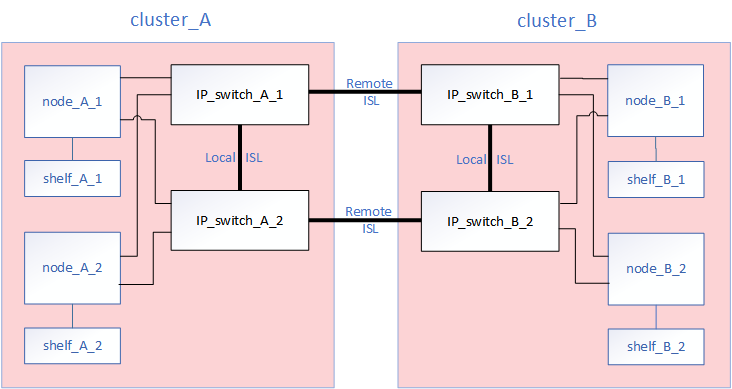
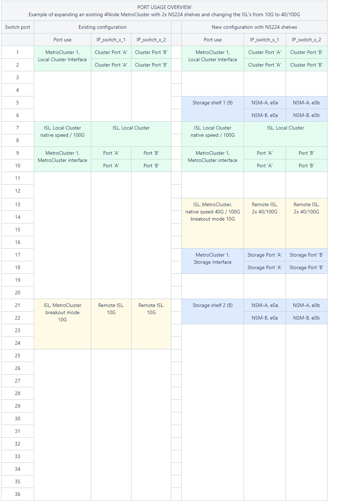

= Einen Switch in einer MetroCluster IP-Konfiguration ersetzen oder anderweitig verwenden
:allow-uri-read: 
:icons: font
:imagesdir: ../media/

[role="lead"]
Möglicherweise müssen Sie einen ausgefallenen Switch ersetzen, einen Switch aktualisieren oder herunterstufen oder die Verwendung vorhandener MetroCluster IP-Switches ändern.

CAUTION: Wenn ein Schalteraustausch auf den Plattformen AFF A220, AFF A250 oder FAS2750 erforderlich ist, siehe link:https://kb.netapp.com/on-prem/ontap/mc/MC-KBs/Cluster_and_HA_communication_issues_during_back-end_switch_replacement["der Knowledge Base Artikel „Cluster- und HA-Kommunikationsprobleme beim Austausch von Backend-Switches“"^].

.Über diese Aufgabe
Dieses Verfahren gilt, wenn Sie NetApp Validated Switches verwenden. Wenn Sie MetroCluster-konforme Switches verwenden, wenden Sie sich an den Switch-Anbieter.

link:enable-console-logging-before-maintenance.html["Aktivieren Sie die Konsolenprotokollierung"] Bevor Sie diese Aufgabe ausführen.

[NOTE]
====
Gemischte Verbindungsgeschwindigkeiten werden auf Plattformen, die eine X60134A Netzwerkkarte verwenden, nicht unterstützt. Ob Ihre Plattform betroffen ist, kann der  https://hwu.netapp.com/["Hardware Universe"^] entnommen werden.

Wenn ein Switch mit 25G-Ports durch einen neuen Switch mit 100G-Ports auf einer betroffenen Plattform ersetzt wird (zum Beispiel ein BES-53248 Switch durch einen Cisco 9336C Switch auf einer AFF A50 Plattform), siehe link:https://kb.netapp.com/on-prem/ontap/mc/MC-KBs/100G_link_not_coming_online_during_MetroCluster_back-end_switch_replacement?caseId=2010523490["der Knowledge Base Artikel „100G-Link kommt während des MetroCluster Back-End-Switch-Austauschs nicht online“"^].

====
Dieses Verfahren unterstützt die folgenden Konvertierungen:

* Ändern des Switch-Anbieters, -Typs oder beider Typen. Der neue Switch kann mit dem alten Schalter identisch sein, wenn ein Switch ausgefallen ist, oder Sie können den Switch-Typ ändern (Upgrade oder Downgrade des Schalters).
+
Um beispielsweise eine MetroCluster IP-Konfiguration von einer Konfiguration mit vier Nodes mit AFF A400 Controllern und BES-53248 Switches auf eine Konfiguration mit acht Nodes mit AFF A400 Controllern zu erweitern, müssen Sie die Switches auf einen unterstützten Typ für die Konfiguration ändern, da BES-53248 Switches in der neuen Konfiguration nicht unterstützt werden.

+
Wenn Sie einen defekten Switch durch denselben Switch-Typ ersetzen möchten, tauschen Sie nur den ausgefallenen Switch aus. Wenn Sie einen Switch aktualisieren oder herunterstufen möchten, müssen Sie zwei Switches anpassen, die sich im gleichen Netzwerk befinden. Zwei Switches befinden sich im selben Netzwerk, wenn sie mit einer ISL (Inter-Switch Link) verbunden sind und sich nicht am selben Standort befinden. Netzwerk 1 umfasst z. B. IP_Switch_A_1 und IP_Switch_B_1, Netzwerk 2 enthält IP_Switch_A_2 und IP_Switch_B_2, wie in der folgenden Abbildung dargestellt:

+

+

NOTE: Wenn Sie einen Switch ersetzen oder auf verschiedene Switches aktualisieren, können Sie die Switches vorkonfigurieren, indem Sie die Switch-Firmware und die RCF-Datei installieren.

* Konvertieren einer MetroCluster IP-Konfiguration in eine MetroCluster IP-Konfiguration mit MetroCluster-Switches für Shared Storage.
+
Wenn Sie beispielsweise über eine regelmäßige MetroCluster IP-Konfiguration mit AFF A700 Controllern verfügen und die MetroCluster neu konfigurieren möchten, um NS224-Shelfs mit denselben Switches zu verbinden.

+
[NOTE]
====
** Wenn Sie Shelfs in einer MetroCluster IP-Konfiguration mithilfe von MetroCluster IP-Switches für gemeinsamen Speicher hinzufügen oder entfernen, führen Sie die Schritte in aus link:https://docs.netapp.com/us-en/ontap-metrocluster/maintain/task_add_shelves_using_shared_storage.html["Hinzufügen von Shelfs zu einer MetroCluster IP mithilfe von MetroCluster-Switches mit Shared-Storage"]
** Die MetroCluster IP-Konfiguration stellt möglicherweise bereits eine direkte Verbindung zu NS224-Shelfs oder zu dedizierten Storage-Switches her.

====

[[port_usage_worksheet]]
.Arbeitsblatt zur Portnutzung
Im Folgenden finden Sie ein Beispiel-Arbeitsblatt zum Konvertieren einer MetroCluster IP-Konfiguration in eine Konfiguration mit gemeinsamem Speicher, bei der zwei NS224-Shelfs unter Verwendung der vorhandenen Switches verbunden werden.

Arbeitsblattdefinitionen:

* Vorhandene Konfiguration: Verkabelung der vorhandenen MetroCluster-Konfiguration.
* Neue Konfiguration mit NS224 Shelfs: Die Zielkonfiguration, bei der die Switches zwischen Storage und MetroCluster gemeinsam genutzt werden

Die hervorgehobenen Felder in diesem Arbeitsblatt geben Folgendes an:

* Grün: Sie müssen die Verkabelung nicht ändern.
* Gelb: Sie müssen Ports mit derselben oder einer anderen Konfiguration verschieben.
* Blau: Ports, die neue Verbindungen sind.

.Schritte
. [[all_step1]]Überprüfen Sie den Zustand der Konfiguration.
+
.. Vergewissern Sie sich, dass die MetroCluster für jedes Cluster im normalen Modus konfiguriert ist: `*metrocluster show*`
+
[listing]
----
cluster_A::> metrocluster show
Cluster                   Entry Name          State
------------------------- ------------------- -----------
 Local: cluster_A         Configuration state configured
                          Mode                normal
                          AUSO Failure Domain auso-on-cluster-disaster
Remote: cluster_B         Configuration state configured
                          Mode                normal
                          AUSO Failure Domain auso-on-cluster-disaster
----
.. Vergewissern Sie sich, dass die Spiegelung auf jedem Knoten aktiviert ist: `*metrocluster node show*`
+
[listing]
----
cluster_A::> metrocluster node show
DR                           Configuration  DR
Group Cluster Node           State          Mirroring Mode
----- ------- -------------- -------------- --------- --------------------
1     cluster_A
              node_A_1       configured     enabled   normal
      cluster_B
              node_B_1       configured     enabled   normal
2 entries were displayed.
----
.. Prüfen Sie, ob die MetroCluster-Komponenten ordnungsgemäß sind: `*metrocluster check run*`
+
[listing]
----
cluster_A::> metrocluster check run

Last Checked On: 10/1/2014 16:03:37

Component           Result
------------------- ---------
nodes               ok
lifs                ok
config-replication  ok
aggregates          ok
4 entries were displayed.

Command completed. Use the "metrocluster check show -instance" command or sub-commands in "metrocluster check" directory for detailed results.
To check if the nodes are ready to do a switchover or switchback operation, run "metrocluster switchover -simulate" or "metrocluster switchback -simulate", respectively.
----
.. Vergewissern Sie sich, dass es keine Systemzustandsmeldungen gibt: `*system health alert show*`

. Wenn Ihre MetroCluster IP Konfiguration NVMe Shelves umfasst, die mit den MetroCluster IP Switches verbunden sind, dienen die folgenden Befehle zur Überprüfung des Status der Shelves.
+
.. Anzeige des Shelf Status:
+
`storage shelf show`

+
.Beispiel anzeigen
[%collapsible]
====
[listing]
----
cluster_A::> storage shelf show
                                                        Module  Operational
       Shelf Name Shelf ID Serial Number   Model        Type    Status
----------------- -------- --------------- ------------ ------- -----------
              1.0        0 952123456789    NS224NSM100  NSM100  Normal
              1.2        0 952987654321    NS224NSM100  NSM100  Normal
cluster_A::>
----
====
.. Die Shelf-Konnektivität für die an den Switch angeschlossenen NVMe Shelves wird angezeigt:
+
`storage shelf show -shelf <shelf_name> -connectivity`

+
.Beispiel anzeigen
[%collapsible]
====
[listing]
----
cluster_A::> storage shelf show -shelf 1.0 -connectivity
            Shelf Name: 1.0
             Stack ID: 1
             Shelf ID: 0
            Shelf UID: 00:00:00:00:00:00:00:00
        Serial Number: 952123456789
          Module Type: NSM100
                Model: NS224NSM100
         Shelf Vendor: NETAPP
           Disk Count: 24
      Connection Type: NVMe
          Shelf State: Online
               Status: Normal
Paths:

Controller         Initiator Initiator Side Switch Port Target Side Switch Port    Target Port        TPGN
------------------ --------- -------------------------- -------------------------- ------------------ ------
cluster_A-01       0x        -                          0x                         05000005abff0000   67
cluster_A-02       0x        -                          0x                         030f0005abff0000   44

cluster_A::>
----
====
.. Falls erforderlich, die Namen der Remote-Geräte (MetroCluster Switches) erfassen:
+
.Beispiel anzeigen
[%collapsible]
====
[listing]
----
cluster_A::> storage shelf port show -fields remote-device

shelf id remote-device
----- -- -------------
1.0   0  IP_switch_A_1
1.0   1  IP_switch_B_1
1.0   2  IP_switch_A_2
1.0   3  IP_switch_B_2
4 entries were displayed
----
====
.. Anzeige der Shelf Port-Konnektivität für die an den Switch angeschlossenen NVMe Shelves:
+
`storage shelf port show -remote-device <switch name>`

+
.Beispiel anzeigen
[%collapsible]
====
[listing]
----
cluster_A::> storage shelf port show -remote-device IP_switch_A_1

Shelf ID Module State        Internal?
----- -- ------ ------------ ---------
1.0
       1 A      connected    false
       3 B      connected    false
1.2
       1 A      connected    false
       3 B      connected    false
4 entries were displayed.

cluster_A::>
----
====

. Konfigurieren Sie den neuen Switch vor der Installation.
+
Bei der Wiederverwendung vorhandener Switches geht es weiter mit <<existing_disconnect,der Schritt, um die Verbindungen vom alten Switch zu trennen>>.

+

NOTE: Wenn Sie die Switches aktualisieren oder verkleinern, müssen Sie alle Switches im Netzwerk konfigurieren.

+
Befolgen Sie die Schritte für Ihren Switch-Anbieter:

+
Stellen Sie sicher, dass Sie die korrekte RCF-Datei für den Schalter _A_1, _A_2, _B_1 oder _B_2 anwenden. Wenn der neue Switch mit dem alten Switch identisch ist, müssen Sie dieselbe RCF-Datei anwenden.

+
Wenn Sie einen Switch aktualisieren oder herunterstufen, wenden Sie die neueste unterstützte RCF-Datei für den neuen Switch an.

+
** link:../install-ip/task_switch_config_broadcom.html["Konfigurieren Sie Broadcom IP-Switches"]
** link:../install-ip/task_switch_config_cisco.html["Konfigurieren Sie Cisco IP-Switches"]
** link:../install-ip/task_switch_config_nvidia.html["Konfigurieren Sie NVIDIA IP-Switches"]

. link:../install-ip/switch-move-cluster-lifs.html["Die Cluster-LIFs verschieben"].
+

NOTE: Die Switches sind in folgender Reihenfolge zu aktualisieren: Switch_A_1, Switch_B_1, Switch_A_2, Switch_B_2. Die Schritte zum Verschieben der Cluster-LIFs auf das zweite Fabric (Switch_A_2, Switch_B_2) sind nach der Konfiguration der Switches im ersten Fabric (Switch_A_1, Switch_B_1) zu wiederholen. Siehe link:../install-ip/task_install_and_cable_the_mcc_components.html["Informationen zur Konfiguration der MetroCluster IP-Switches"].

. [[existing_disconnect]]Die Verbindungen vom alten Switch werden getrennt.
+

NOTE: Sie trennen nur Verbindungen, die nicht denselben Port in der alten und neuen Konfiguration verwenden. Wenn Sie neue Switches verwenden, müssen Sie alle Verbindungen trennen.

+
Entfernen Sie die Anschlüsse in der folgenden Reihenfolge:

+
.. Trennen Sie die lokalen Cluster-Schnittstellen
.. Trennen Sie die lokalen Cluster-ISLs
.. Trennen Sie die MetroCluster IP-Schnittstellen
.. Trennen Sie die MetroCluster-ISLs
+
Im Beispiel <<port_usage_worksheet>>Die Schalter ändern sich nicht. Die MetroCluster-ISLs werden verschoben und müssen getrennt werden. Sie müssen die grün markierten Verbindungen auf dem Arbeitsblatt nicht trennen.

. Wenn Sie neue Schalter verwenden, schalten Sie den alten Schalter aus, entfernen Sie die Kabel, und entfernen Sie den alten Schalter.
+
Bei Wiederverwendung vorhandener Switches geht es weiter mit <<existing_configure,der Schritt zur Konfiguration der vorhandenen Switches>>.

+

NOTE: Verkabeln Sie die neuen Switches mit Ausnahme der Verwaltungsschnittstelle (falls verwendet) nicht.

. [[existing_configure]]Konfiguration der vorhandenen Switches.
+
Wenn Sie die Switches bereits vorkonfiguriert haben, können Sie diesen Schritt überspringen.

+
Führen Sie zum Konfigurieren der vorhandenen Switches die Schritte zum Installieren und Aktualisieren der Firmware- und RCF-Dateien aus:

+
** link:https://docs.netapp.com/us-en/ontap-metrocluster/maintain/task_upgrade_firmware_on_mcc_ip_switches.html["Aktualisieren der Firmware auf MetroCluster IP Switches"]
** link:https://docs.netapp.com/us-en/ontap-metrocluster/maintain/task_upgrade_rcf_files_on_mcc_ip_switches.html["Aktualisieren Sie RCF-Dateien auf MetroCluster IP-Switches"]

. Verkabeln Sie die Schalter.
+
Sie können die Schritte in link:../install-ip/using_rcf_generator.html["MetroCluster IP-Switches verkabeln"] ausführen.

+
Verkabeln Sie die Schalter in der folgenden Reihenfolge (falls erforderlich):

+
.. Verkabeln Sie die ISLs mit dem Remote-Standort.
.. Verkabeln Sie die MetroCluster IP-Schnittstellen.
.. Verkabeln Sie die lokalen Cluster-Schnittstellen.
+
[NOTE]
====
*** Die verwendeten Ports können von denen auf dem alten Switch abweichen, wenn der Switch-Typ anders ist. Wenn Sie die Switches aktualisieren oder verkleinern, müssen Sie die lokalen ISLs nicht * verkabeln. Verkabeln Sie die lokalen ISLs nur, wenn Sie die Switches im zweiten Netzwerk aktualisieren oder herunterstufen und beide Switches an einem Standort den gleichen Typ und die gleiche Verkabelung aufweisen.

====

. Schalten Sie den Schalter ein oder schalten Sie den Schalter ein.
+
Wenn der neue Switch identisch ist, kann der neue Switch eingeschaltet werden. Bei einem Upgrade oder Downgrade der Switches können beide Switches eingeschaltet werden.

. Die vorherigen Schritte werden für den zweiten Fabric (Switch_A_2 und Switch_B_2) wiederholt, nachdem der erste Fabric (Switch_A_1 und Switch_B_1) aktualisiert wurde.
+

NOTE: Wenn Sie einen defekten Switch durch einen Switch desselben Typs ersetzen, müssen Sie nur den defekten Switch aktualisieren und die Schritte für den zweiten Fabric nicht wiederholen.

. Schließen Sie die lokale Clusterverkabelung ab.
+
.. Wenn die lokalen Cluster-Schnittstellen mit einem Switch verbunden sind:
+
... Verkabeln Sie die lokalen Cluster-ISLs.

.. Wenn die lokalen Clusterschnittstellen *nicht* mit einem Switch verbunden sind:
+
... Die link:https://docs.netapp.com/us-en/ontap-systems-switches/switch-bes-53248/migrate-to-2n-switched.html["Migration zu einer NetApp Cluster-Umgebung mit Switch"^]Vorgehensweise dient dazu, einen Cluster ohne Switches in einen Cluster mit Switches umzuwandeln. Die in link:https://docs.netapp.com/us-en/ontap-metrocluster/install-ip/using_rcf_generator.html["Installation und Konfiguration von MetroCluster IP"] oder in den RCF-Verkabelungsdateien angegebenen Ports werden verwendet, um die lokale Clusterschnittstelle zu verbinden.

. Wiederholen Sie die Schritte, um zu überprüfen, ob die MetroCluster-Konfiguration ordnungsgemäß ist <<all_step1,Schritt 1>>.
. Alle Cluster-LIFs auf ihren Home Port zurücksetzen.
+

CAUTION: Die Cluster LIFs dürfen erst dann auf ihre Home Ports zurückgesetzt werden, wenn die vorherigen Schritte für alle Switches abgeschlossen sind, die ein Update erfordern.

+
.. Ändern Sie alle Cluster-LIFs, um die automatische Zurücksetzung erneut zu aktivieren:
+
[source, cli]
----
network interface modify -vserver <vserver_name> -lif <lif_name> -auto-revert true
----
.. Alle Cluster-LIFs, die sich derzeit nicht auf ihren Home Ports befinden, manuell auf ihre Home Ports zurücksetzen:
+
`network interface revert -vserver Cluster -lif *`

. Verschieben Sie optional die NS224-Shelfs.
+
Wenn Sie eine MetroCluster IP-Konfiguration neu konfigurieren, bei der keine NS224-Shelfs mit den MetroCluster IP-Switches verbunden werden, gehen Sie wie folgt vor, um die NS224-Shelfs hinzuzufügen oder zu verschieben:

+
** link:https://docs.netapp.com/us-en/ontap-metrocluster/maintain/task_add_shelves_using_shared_storage.html["Hinzufügen von Shelfs zu einer MetroCluster IP mithilfe von MetroCluster-Switches mit Shared-Storage"]
** link:https://docs.netapp.com/us-en/ontap-systems-switches/switch-cisco-9336c-fx2-shared/migrate-from-switchless-cluster-dat-storage.html["Migrieren Sie von einem Cluster ohne Switches mit Direct-Attached Storage"^]
** link:https://docs.netapp.com/us-en/ontap-systems-switches/switch-cisco-9336c-fx2-shared/migrate-from-switchless-configuration-sat-storage.html["Migrieren Sie mit der erneuten Nutzung der Storage-Switches von einer Konfiguration ohne Switches mit Switch-Attached Storage"^]

.Nachdem Sie fertig sind
link:../install-ip/task-configure-log-collection-mccip.html["Konfigurieren der Protokollsammlung auf einem MetroCluster-IP-Switch"]
